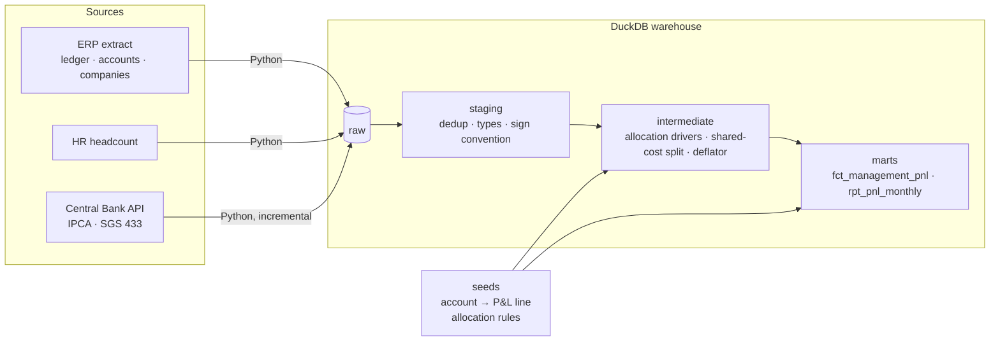

# Management P&L with dbt — shared-cost allocation and inflation-adjusted results

[](https://github.com/eduardohaas/management-pnl-dbt/actions/workflows/dbt.yml)
[](https://eduardohaas.github.io/management-pnl-dbt/)

A group of companies shares one back office. Finance needs to know **how profitable each company really is** once that back office is paid for, and **how much of the growth is real** after inflation. This project turns a messy ERP extract into that answer, with the business rules versioned, tested and documented.

It is a public, synthetic version of the kind of management P&L (Brazilian *DRE gerencial*) I build for clients. The data is generated, the rules and the engineering are the real thing.

## What the model shows (FY2025)

| Company | Net revenue | Gross margin | Operating margin before allocation | After allocation | Net margin |
| --- | ---: | ---: | ---: | ---: | ---: |
| C01 · Food manufacturing | BRL 44.8 M | 37.8% | 18.4% | **13.4%** | 9.5% |
| C02 · Wholesale distribution | BRL 30.5 M | 28.0% | 12.2% | **8.6%** | 5.4% |
| C03 · Logistics services | BRL 13.7 M | 49.5% | 24.9% | **16.1%** | 11.8% |

- **Logistics looks like the star until it pays its share.** It loses 8.8 points of margin to the shared service center, because payroll and IT are allocated by headcount and logistics is people-heavy.
- **Nominal revenue grew 6.7% from 2024 to 2025; in constant Dec/2025 prices it grew 1.6%.** Most of the growth is inflation (IPCA from the Central Bank API).

## Architecture



| Layer | Models | Job |
| --- | --- | --- |
| **raw** | loaded by `ingestion/` | ERP extract as it comes (duplicated lines, `DD/MM/YYYY` strings, debit/credit columns) and IPCA from the API |
| **staging** | `stg_erp__*`, `stg_hr__headcount`, `stg_bcb__ipca_monthly` | Deduplicate, cast, trim, one sign convention (revenue +, expenses −) |
| **intermediate** | `int_ledger_by_pnl_line`, `int_allocation_drivers`, `int_shared_costs_allocated`, `int_ipca_deflator` | Business rules: map accounts to P&L lines, compute driver shares, split shared costs, chain the price index |
| **marts** | `fct_management_pnl`, `rpt_pnl_monthly`, `dim_companies`, `dim_accounts` | Long P&L by company × month × line (nominal and real BRL) and a wide report with subtotals and margins |

## Business rules live in seeds, not in SQL

Finance changes rules more often than engineers change code, so the rules are CSV files under version control:

- [`account_pnl_mapping.csv`](seeds/account_pnl_mapping.csv) — which P&L line each ledger account rolls up to. A new ERP account without a mapping **fails the build** (`dim_accounts.pnl_line` is `not_null`).
- [`allocation_rules.csv`](seeds/allocation_rules.csv) — which driver splits each shared cost: payroll, rent and IT by **headcount**, third-party services by **net revenue**.
- [`pnl_lines.csv`](seeds/pnl_lines.csv) — labels and order of the P&L lines.

The base month for inflation adjustment is a dbt var: `dbt build --vars '{real_terms_base_month: "2025-06-01"}'`.

## Tests that protect the numbers

38 tests run on every push as part of `dbt build`:

- **Unit test** — [`shared_costs_are_split_by_the_driver_of_each_account`](models/intermediate/_intermediate__models.yml): fixed inputs, exact expected split. Break the allocation formula and it fails.
- **Reconciliation** — [`assert_group_net_income_reconciles_to_ledger`](tests/assert_group_net_income_reconciles_to_ledger.sql): allocation moves costs between companies but never creates money; the group's P&L must equal the raw ledger every month.
- **Conservation** — [`assert_shared_costs_fully_allocated`](tests/assert_shared_costs_fully_allocated.sql): every BRL spent by the shared service center lands on a company.
- **Data tests** — uniqueness after dedup, referential integrity to accounts and companies, accepted ranges for margins, driver shares and IPCA.
- **Source freshness** — warns if the IPCA load is more than 35 days old.

## CI and docs

GitHub Actions ([`dbt.yml`](.github/workflows/dbt.yml)) runs on every push and every Monday: ingest → freshness → `dbt build` → publish the dbt docs (lineage graph included) to GitHub Pages: **[eduardohaas.github.io/management-pnl-dbt](https://eduardohaas.github.io/management-pnl-dbt/)**.

## Run it locally

Needs Python 3.11. No cloud account, no credentials, no cost.

```bash
make setup   # venv + dependencies + dbt packages
make all     # load raw data and run dbt build
make docs    # open the docs with the lineage graph
```

## Stack

dbt Core 1.12 · DuckDB · Python (requests, duckdb) · dbt_utils · GitHub Actions · GitHub Pages

---

Built by [Eduardo Haas](https://github.com/eduardohaas) · [LinkedIn](https://www.linkedin.com/in/eduardo-haas-ab784b127/)
